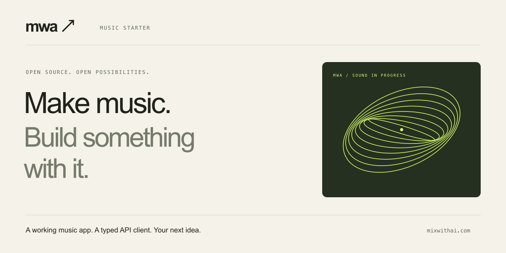

<p align="center"></p>

# MWA Music Starter

**A working starting point for your next music app, powered by the [MWA API](https://mixwithai.com/settings/api?utm_source=github&utm_medium=readme&utm_campaign=music-starter).**

Describe a track, follow its progress, play the result, and build your own experience around it. Includes a responsive interface, a server-side JavaScript client with TypeScript definitions, examples, and a preview that works without an account.

[Get an API key](https://mixwithai.com/settings/api?utm_source=github&utm_medium=readme&utm_campaign=music-starter) · [API guide](docs/api.md) · [Build something](docs/build-with-mwa.md) · [SDK](packages/sdk/README.md)

<!-- repository-links:start -->
If this helps you build something, star the repository and share your project in an issue. Stars help other music developers find it.
<!-- repository-links:end -->

## Try it in one command

With **Node.js 22.16 or newer**, open this folder and run:

```sh
npm start
```

Open **http://127.0.0.1:3008**. No dependency installation or API key is needed for preview mode.

The preview simulates job progress and plays an original **15-second synthesized loop**. It does **not** generate music from your prompt, contact MWA, or use credits. The interface labels this clearly.

## Generate real music

For guided local setup, run `npm run setup`, choose Live, and provide a protected key file path. The wizard keeps keys on the server and makes no API request. The interface also includes a three-step first-track guide. [Setup guide](docs/setup-and-sharing.md).

1. Get an approved key and API credits from [MWA API access](https://mixwithai.com/settings/api?utm_source=github&utm_medium=readme&utm_campaign=music-starter). A key marked Pending needs access approval. API credits are separate from app credits.
2. Copy `.env.example` to `.env` inside this folder.
3. Set `MWA_MODE=live` and set `MWA_API_KEY` to your key. Keep the key on your server.
4. Restart `npm start`. The interface now displays **LIVE / MWA API**.
5. Describe a track and choose **Generate music**. Each new generation or revision can consume API credits.

This starter targets the public **MWA EDM v1** profile: three-minute electronic tracks at 128 BPM, audio downloads, and project JSON. The supported genres are house, tech house, melodic house, afro house, deep house, progressive house, bass house, techno, and trance. This profile does not supply separate stems, MIDI, or preset downloads. Availability depends on your key and the enabled service.

## What you can build on

- **Music playground:** prompts, genre choices, progress, playback, downloads, and session history.
- **Revision workflow:** request a variation or remix of a generation from the current session.
- **A/B listening room:** compare ready originals and variations with one player, preserved time position, and two labeled fixtures that run without a key. [Comparison recipe](docs/comparison.md).
- **Interactive code explorer:** JavaScript, Python, cURL, and request JSON follow the prompt, genre, title, and selected revision. Copying or editing examples makes no API request.
- **Curated showcase:** publish only approved public audio URLs, credits, and optional prompts through `showcase.json`. The initial list is empty while campaign tracks are being selected. [Showcase guide](docs/showcase.md).
- **SDK:** typed generation, cancellation, polling, timeouts, rate-limit handling, export recovery, reference guidance and private reference uploads for guided revisions. Reference uploads require beta enablement; the starter UI demonstrates generation and A/B revisions.
- **Guided setup:** a terminal wizard and an in-app checklist from preview to a live track.
- **Share cards:** download an original PNG and copy a campaign caption after a track is ready. Prompts are optional; preview cards stay labeled. No upload or automatic posting. [Sharing guide](docs/setup-and-sharing.md).
- **Server example:** API credentials stay on the server; local sessions own their jobs.
- **Developer recipes:** a music app, a soundtrack workflow, and a version comparison interface.
- **Runnable use cases:** prompt-to-music, production-directed mix/master revisions, sound-character exploration, private reference-guided variations, creator soundtracks and A/B remixes. [Recipes, source and limits](examples/use-cases/README.md).
- **Project workspace:** view and edit an original local project draft, import/export its public JSON, optionally read a bounded Ableton snapshot, and review selected context before prefilling a new generation. Open a generation's actual source project in MWA Studio. Draft editing does not apply to Live or the MWA source. [Ableton setup, API boundary and next phases](docs/ableton-projects.md).
- **Result → Ableton:** explicitly enable a separate local adapter to preview and import a ready MWA full-audio result into a dedicated empty audio track. Set/track rechecks, private audio cache, operation receipts and verified readback; no automatic application or existing-track replacement. Fixture tested; real Live acceptance pending. [Setup and limits](docs/ableton-audio-import.md).
- **Campaign kit:** original social artwork, launch copy, a demo script, and GitHub setup instructions.

The included artwork and preview synthesizer were made for this starter. It needs no external image, font, audio, or analytics service.

## Use the client in your own project

```js
import { MwaClient } from "./packages/sdk/index.js";

const mwa = new MwaClient({ apiKey: process.env.MWA_API_KEY });

// Save this key and input in your app before submitting.
// Reuse both if a request is interrupted.
const idempotencyKey = crypto.randomUUID();
const job = await mwa.generate({
  prompt: "A warm deep house track with soft chords and a sunset atmosphere",
  genre: "deep_house",
  title: "Golden hour",
}, { idempotencyKey });

const result = await mwa.wait(job.generation_id, {
  onProgress: job => console.log(job.status, job.progress),
});

if (result.audio_export?.status === "ready") {
  console.log(result.audio_export.download_url);
} else {
  console.log(result.status, result.error?.message ?? "Audio is not ready.");
}
```

The client is included locally; these instructions do not assume an npm package has been published. Copy `packages/sdk` into your project or install that folder with `npm install /path/to/packages/sdk`. See the [SDK guide](packages/sdk/README.md).

For a package-installable beta candidate, run `npm run sdk:pack`. It creates a separate five-file SDK tarball, compares extracted source bytes, checks the dependency/import boundary, and exercises all operations with offline HTTP fixtures. [Pilot and publication guide](docs/sdk-release.md). Packing does not publish to npm or establish live API readiness.

## Repository map

```text
public/          Music interface and original SVG artwork
server/          Local API adapter and clearly labeled preview fixture
packages/sdk/    Independent MWA HTTP client and TypeScript definitions
integrations/    Optional upstream Ableton reader; separate from the SDK
examples/        Runnable generation and revision examples
docs/            Public API usage, extension recipes, and publishing
marketing/       Campaign copy, demo script, and social artwork
tests/           Offline client, HTTP, isolation, and fixture tests
scripts/         Release checks, GitHub configuration, clean archive
```

## Run checks

```sh
npm install
npm run verify
```

After installing the TypeScript development dependency, checks run offline and make no paid API requests. The server and SDK use Node's built-in APIs, so there are no runtime dependencies. CI tests Node 22 and 24.

## Host a campaign preview

Preview mode can be hosted publicly. Set `MWA_MODE=demo`, `HOST=0.0.0.0`, and `PUBLIC_ORIGIN` to the exact HTTPS origin your proxy serves. Keep `MWA_API_KEY` absent. A [Dockerfile](Dockerfile) is included.

Live mode intentionally binds to localhost. The starter is a single-user development example; publishing a live application requires your own authentication, persistent job ownership, per-user quotas, and billing controls. An API key must never become an anonymous public generation proxy. See [deployment](docs/publishing.md).

## Share your version

Build a new interface, add an integration, or contribute an example. We welcome small, runnable projects with clear setup instructions. [Contributing guide](CONTRIBUTING.md).

The code in this repository is MIT licensed. MWA's hosted service, account access, usage charges, and generated-output terms are separate from the code license. MixWithAI branding identifies the service; avoid presenting your fork as an official MWA product.

The normal starter and SDK have no runtime dependencies. Optional Ableton capture
installs its own pinned upstream dependency with `npm run ableton:setup`; activate
the matching Remote Script, then run `npm run ableton` and open `/project`.
Only explicit capture reads Live. This is a public observational reader, not the
private MWA bridge. `npm run ableton:import` separately enables reviewed full-audio
placement in live mode; normal commands remain read-only. Full hosted project
import and draft/project synchronization back to Live remain next phases.
