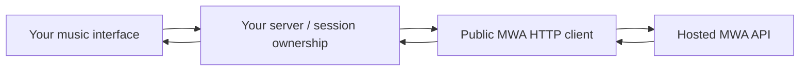

# Public starter architecture

The starter owns the interface, request handling, and client-side integration experience. The hosted API performs real music generation. The API key lives only in the server environment.

All starter implementation code and artwork were independently authored for this public project. Its integration boundary consists of public HTTP endpoints, request/response fields, and account access requirements. It includes no generation engine, private application implementation, service credentials, catalog data, model weights, production configuration, or existing Git history.

## Preview versus live

In preview mode, the adapter uses `DemoService`. It simulates the asynchronous workflow and serves a 15-second WAV synthesized from elementary oscillators and noise. It makes no API calls and does not interpret the prompt.

In live mode, the adapter calls the public API through `MwaClient`. It accepts a small set of user inputs, constructs the supported request, and returns a limited presentation response to the browser. Audio downloads come from signed URLs returned by the public API.

The public showcase reads only explicit publication-approved metadata from `showcase.json`; its initial list is empty. The A/B fixtures are separate original synthesized examples. The browser comparison room uses one native audio element and retains ready session URLs in memory only. Code examples are generated locally from public request fields without contacting the API or reading credentials.

The guided setup wizard writes a protected, loopback-only `.env` after reading a protected key file. It is a local configuration operation with no API call. The browser checklist distinguishes configured access from a ready live track. Share cards render with local canvas and system fonts; only title, genre, an optional prompt, and a fixed MWA campaign link enter the card or caption. No signed output links or audio are uploaded.

## State and recovery

- Each browser receives an opaque HttpOnly session cookie and a separate CSRF token.
- The adapter records which generation IDs belong to that local session.
- A submission uses a caller-generated idempotency key. Concurrent duplicate submissions share one promise; interrupted requests can be retried with the original body and key.
- Recent history is held in memory. Restarting the process clears local sessions and history, but does not cancel remote MWA jobs.
- The browser stores an unfinished request in session storage to allow recovery after a page reload. That can include the local user's prompt, but never an API key.
- Signed output URLs are held in the current page, not stored in browser history records or the example receipts.

Publicly hosted preview mode is suitable for demonstrating this workflow. A live multi-user product needs persistent application state and the additional controls described in `publishing.md`.

## Release boundary

`release-manifest.json` is an explicit list of publishable paths. `npm run check` validates the imports in that list, rejects symlinks, checks JavaScript syntax, and looks for common credentials and local filesystem paths. `npm run release` stages only those files into a fresh archive. Review new manifest entries when extending the project; automated scanning does not establish ownership or safety of future contributions.
